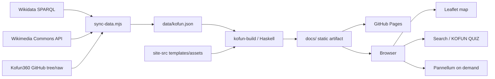

# Developer guide

「古墳めぐり」のアーキテクチャ、Haskellビルド、データ更新、フロントエンド、デプロイの詳細です。

## 1. Architecture at a glance

このプロジェクトは、更新時だけネットワークへ接続し、閲覧時は静的ファイルだけで動く構成です。



大きく3層に分かれます。

1. `scripts/sync-data.mjs`: 外部データの取得、正規化、画像ライセンス取得、Kofun360との統合
2. `app/Main.hs`: JSONの型付き検証と静的サイト生成
3. `site-src/assets/app.js`: ブラウザ内の検索、地図、詳細、今日の古墳、クイズ

外部APIの応答を直接サイト表示へ使いません。`data/kofun.json` を版管理された境界とすることで、通常ビルドの再現性、差分レビュー、外部障害からの独立性を確保しています。

## 2. Repository layout

```text
.
├── app/
│   └── Main.hs                  Haskell静的サイト生成器
├── data/
│   └── kofun.json               正規化済みデータスナップショット
├── scripts/
│   └── sync-data.mjs            外部データ同期
├── site-src/
│   ├── index.html               一般向けページのテンプレート
│   ├── developers.html          開発者向けページのテンプレート
│   ├── assets/
│   │   ├── app.js               ブラウザアプリケーション
│   │   ├── styles.css           共通スタイル
│   │   └── kofun360/            軽量WebPプレビュー
│   ├── manifest.webmanifest
│   └── robots.txt
├── docs/                        Haskellが生成するPages成果物
├── .github/workflows/pages.yml  ビルド・デプロイ
├── kofun-photo.cabal
├── cabal.project
├── THIRD_PARTY.md
└── LICENSE
```

`site-src/` と `data/` が編集元です。`docs/` はGitHub Pagesへそのまま渡せる生成物であり、手編集した内容は次の生成で失われます。

## 3. Why Haskell

Haskellは閲覧リクエストを処理するWebサーバーではなく、公開前の境界として使います。

- Aesonによる型付きJSONデコード
- 不正データを公開前に止めるfail-fast検証
- 同じ入力から同じ静的成果物を作る小さな生成器
- 実行時バックエンドを持たないGitHub Pages構成
- ビルドロジックを副作用の少ない変換として保つ

### `Kofun` build type

`app/Main.hs` は、全表示フィールドをHaskell側で再エンコードしません。ビルド判定に必要な最小フィールドだけを読み、元のJSONバイト列はブラウザ用データへそのまま包みます。

```haskell
data Kofun = Kofun
  { kofunId :: Text
  , kofunName :: Text
  , latitude :: Double
  , longitude :: Double
  , hasImage :: Bool
  , isPanorama :: Bool
  }
```

この方法により、次の性質を両立します。

- ID、名称、座標、メディアフラグという重要な契約はコンパイル済み処理で検査する
- JavaScriptだけが使う任意フィールドを追加しても、Haskell型の不要な変更を避けられる
- JSONを再エンコードしてキー順や表現を変えず、データ差分を読みやすくする

### Build-time validations

`validateRecords` は次を検査します。

- データセットが空でない
- `id` と `name` が空でない
- `id` が一意
- 緯度が `-90..90`、経度が `-180..180`
- `isPanorama == true` のレコードは `hasImage == true`

検証に失敗すると`cabal run kofun-build`が非0で終了し、Pagesへのアップロードは行われません。

### Template rendering

テンプレートでは次の値を使用できます。

| Placeholder | Meaning |
| --- | --- |
| `{{KOFUN_COUNT}}` | 全レコード数 |
| `{{IMAGE_COUNT}}` | `hasImage`が真の件数 |
| `{{PANORAMA_COUNT}}` | `isPanorama`が真の件数 |

生成器はトップ、404、開発者ページ、ブラウザ用データ、静的アセット、manifest、robots、sitemapを`docs/`へ出力します。

## 4. Canonical data model

`data/kofun.json` はオブジェクトの配列です。

| Field | Type | Required | Purpose |
| --- | --- | --- | --- |
| `id` | string | yes | 出典を含む永続的な一意キー |
| `name` | string | yes | 表示名 |
| `reading` | string | yes | 読み。不明は空文字 |
| `aliases` | string[] | yes | 別称と検索語 |
| `group` | string | yes | 古墳群 |
| `description` | string | yes | 短い説明 |
| `lat`, `lng` | number | yes | WGS84 |
| `prefecture` | string | yes | 都道府県絞り込み |
| `location` | string | yes | 公開データ上の所在地 |
| `shape` | string | yes | 墳形。不明は空文字 |
| `length` | string | yes | 単位・推定表現を含む表示値 |
| `period` | string | yes | 時期。不明は空文字 |
| `sources` | string[] | yes | `wikidata`、`kofun360`など |
| `sourceUrl` | string | yes | 主なレコード出典 |
| `articleUrl` | string | yes | 解説記事。不明は空文字 |
| `image` | object/null | yes | 画像と帰属情報 |
| `panoramaUrl` | string | yes | 360°原画像。不明は空文字 |
| `hasImage` | boolean | yes | 表示・集計用 |
| `isPanorama` | boolean | yes | 表示・集計用 |

### Image object

画像がある場合は次を保持します。

```json
{
  "previewUrl": "一覧・詳細用の軽量画像",
  "originalUrl": "原画像",
  "pageUrl": "画像の説明・出典ページ",
  "author": "作者または投稿者",
  "license": "CC BY-SA 4.0",
  "licenseUrl": "ライセンス本文",
  "credit": "指定されたクレジット",
  "alt": "画像の代替説明"
}
```

`pageUrl`、`author`、`license`、`licenseUrl`を落とさないことが重要です。「フリー画像」は無条件利用を意味しません。

## 5. Data synchronization

同期処理はNode.jsで行います。これは、HTTP API処理、GitHub tree JSON、画像メタデータ、ImageMagick起動を小さなスクリプトで扱うためです。

### Wikidata

SPARQLで以下を取得します。

- 日本にある古墳クラスとその下位クラス
- WGS84座標
- 日本語優先の名称・説明
- 日本語別称
- 所在行政区・都道府県
- 画像、年代、長さ、Wikipedia記事

Wikidata部分のIDは`wikidata-Q...`形式です。

### Wikimedia Commons

Wikidataの画像名を50件ずつAction APIへ送り、次を固定します。

- 960px前後のプレビューURL
- 原画像URLとファイル説明ページ
- 作者・クレジット
- ライセンス名とURL
- 画像説明

User-Agentを明示し、429または5xxでは`Retry-After`を考慮して最大3回再試行します。

### Kofun360

GitHub treeから写真パスを読み、フォルダー名に含まれる緯度経度と古墳名を解析します。

- 各古墳の最初のパノラマを代表画像にする
- ImageMagickで軽量WebPプレビューを生成する
- 原画像はローカルへ複製せず、利用者が360°表示を開始した時だけ取得する
- 名称が近く座標距離750m未満のWikidataレコードへ統合する
- 候補がなければKofun360単独レコードとして追加する

この名称・距離ヒューリスティックは完全ではありません。閾値や正規化を変更した時は、統合件数と同名古墳を必ずレビューしてください。

## 6. Browser architecture

ブラウザ部分は依存を抑えたVanilla JavaScriptです。

### State

`app.js`の`state`が次を管理します。

- query
- prefecture
- photoOnly
- panoramaOnly
- source
- view
- cardLimit
- seed

入力イベントは状態を変更し、フィルター、件数、地図、一覧、カードを再描画します。

### Search

検索対象は名称、読み、別称、都道府県、所在地、古墳群、墳形、時期、説明です。NFKC正規化、小文字化、空白と一部表記記号の除去を行います。

読みや別称を`aliases`へ保持すると、「仁徳」から「大仙陵古墳」のような検索ができます。

### Map

- Leaflet 1.9.4
- Canvas renderer
- OpenStreetMap tile layer
- 表示中レコードからマーカーを再構築
- 可視のOpenStreetMap attribution

タイルの一括取得や事前キャッシュは行いません。

### Today and quiz

「今日の古墳」は日付から安定したハッシュを作って選びます。同じ日には同じ古墳を表示し、サーバー側のスケジューラーを必要としません。

KOFUN QUIZは掲載データから5問を作ります。都道府県、名称、画像などの正答と、同じデータセットから選んだ誤答候補を組み合わせます。

### Panorama

Pannellumは詳細ダイアログで利用者が開始ボタンを押した後に初期化します。トップ表示だけで大きな360°原画像を転送しない設計です。

## 7. Local development

### Requirements

- GHC 9.8以降
- cabal-install
- プレビュー用HTTPサーバー
- データ同期時のみ: Node.js 20以降、ImageMagick、ネットワーク

### Build and preview

```sh
cabal update
cabal build kofun-build
cabal run kofun-build
python3 -m http.server 8000 --directory docs
```

<http://localhost:8000/> と <http://localhost:8000/developers.html> を確認します。

`file://`では、地図ライブラリ、ブラウザのセキュリティ制約、相対URLの挙動がHTTP配信と異なるため検証しません。

### Refresh data

```sh
node scripts/sync-data.mjs
cabal run kofun-build
git diff -- data/kofun.json site-src/assets/kofun360 docs
```

データ更新は通常のUI変更とは分けてレビューするのが安全です。

### Minimum checks

```sh
cabal check
cabal build kofun-build
cabal run kofun-build
node --check scripts/sync-data.mjs
node --check site-src/assets/app.js
git diff --check
```

ブラウザでは最低限、次を確認します。

- PC幅と390px幅で横スクロールがない
- 初期件数がJSON件数と一致する
- 名称、別称、都道府県検索
- 画像・360°・出典フィルター
- 地図と一覧の切り替え
- 詳細ダイアログの帰属表示
- KOFUN QUIZの回答と結果
- コンソールエラーがない

## 8. CI and GitHub Pages

`.github/workflows/pages.yml` は`main`へのpushと手動実行に対応します。

### Build job

1. Checkout
2. GHC 9.10.3 / cabal 3.16.1.0
3. Cabal storeと`dist-newstyle`のキャッシュ
4. `cabal build kofun-build`
5. `cabal run kofun-build`
6. Pages設定確認
7. `docs/`をPages artifactとしてアップロード

### Deploy job

build成功後だけ実行し、GitHub Pagesへ保存済みartifactを配信します。

- workflow全体: `contents: read`
- deploy jobだけ: `pages: write`
- GitHub Pages OIDC: `id-token: write`

リポジトリ設定のPages Sourceは`GitHub Actions`である必要があります。

## 9. Licensing boundary

コードのライセンスは0BSDですが、データと画像は別です。

直接収録できるのは、再配布条件を確認し、必要な帰属を保持できるものだけです。

- Wikidata: CC0
- Kofun360: CC0
- Wikimedia Commons: ファイルごとのライセンス
- OpenStreetMap: ODbLと表示帰属

奈良女子大学 全国古墳データベース、古墳マップ、文化財総覧WebGISは研究導線としてリンクします。個別の再配布許諾が確認できるまでは、レコードや画像を自動複製しません。

詳細は[THIRD_PARTY.md](THIRD_PARTY.md)を参照してください。

## 10. Scaling and extension

### More records

数千件程度は現在のクライアント内検索で扱えます。数万件規模になった場合は次の順で検討します。

1. 都道府県別JSONチャンク
2. 生成時の軽量検索インデックス
3. Web Workerでの検索
4. 地図の空間インデックスまたはクラスタリング
5. 画像のより小さい`srcset`生成

### New data provider

1. 利用規約と画像ライセンスを確認する
2. `sync-data.mjs`へ取得・変換関数を追加する
3. 正規スキーマへ変換する
4. 安定した出典付きIDを作る
5. `sources`と`sourceUrl`を保持する
6. 画像の作者・ライセンス・元ページを保持する
7. 統合規則と重複をレビューする
8. `THIRD_PARTY.md`を更新する
9. Haskell生成とブラウザ検証を行う

### Stronger validation

将来、Haskell側へ追加しやすい検証は次のとおりです。

- URLのscheme制限
- `hasImage`と`image`オブジェクトの完全一致
- 都道府県名の列挙型検証
- 出典ごとの必須帰属
- 日本周辺の地理的な警告範囲
- JSON Schemaの同時生成

厳格化する際は、未知フィールドを許容してデータモデルの段階的拡張を妨げないことも重要です。
